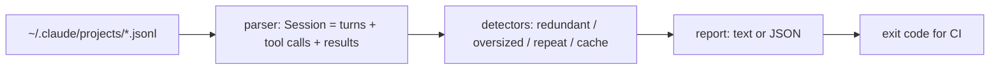

# agentwaste

[](https://github.com/Nithinfgs/agent-waste-audit/actions/workflows/ci.yml)
[](LICENSE)


**Find out where your coding agent wasted tokens, after the fact.** `agentwaste` reads your local
Claude Code session transcripts and reports re-read files, oversized tool output, failing retry loops
and prompt-cache misses, with an estimate of how many tokens each one cost. Offline, no dependencies,
no API keys.

## The problem

Cost tools such as [ccusage](https://github.com/ryoppippi/ccusage) tell you *how much* you used.
Runtime tools such as [context-mode](https://github.com/mksglu/context-mode) try to prevent bloat
as it happens. Neither answers "which specific calls in last night's session were pointless?".
Every tool result stays in the context and is re-read on every later turn, so one 12k-token file
dump early in a long session is paid for again and again. `agentwaste` finds those moments.

## What it detects

| Finding | Meaning |
|---|---|
| `redundant_read` | Same file range read again with identical content and no Edit/Write in between |
| `oversized_output` | One tool result above a size threshold (default 20,000 chars); only the excess is counted |
| `retry_loop` | The same call failed identically 3+ times |
| `repeated_call` | The same non-read call returned byte-identical output 3+ times |
| `cache_miss` | A turn rewrote a large cached prefix with no idle gap to explain it |
| `cache_expiry` | Same, but after >5 minutes idle. Reported for information, counted as 0 |

Each finding carries `tokens` (avoidable, counted once) and `carried` (extra cache-read tokens on
later turns while the content stays in context).

## Install

```bash
git clone https://github.com/Nithinfgs/agent-waste-audit.git
cd agent-waste-audit
pip install .
```

Requires Python 3.9+.

## Quick start

```bash
agentwaste examples/sample_session.jsonl     # bundled synthetic transcript
agentwaste                                   # newest 5 sessions under ~/.claude/projects
agentwaste ~/.claude/projects/<project> -n 20 --top 3
agentwaste --json | jq '.[0].findings[0]'
agentwaste session.jsonl --fail-over 15      # exit 1 if >15% of new tokens were avoidable
```

Example output (from the bundled synthetic sample, not real usage):

```text
Session sample_session
  13 turns, 13 tool calls, 54,439 new tokens, 240,500 cache-read tokens
  avoidable ~13,080 tokens  [#####...............] 24.0% of new tokens
  plus ~57,596 tokens re-read from cache on later turns
  - [oversized_output] Read /app/server.py returned ~9,000 tokens
      ~4,000 tokens (+48,000 carried) - 36,000 characters; threshold 20,000
      tip: Narrow it: grep/head/tail, Read with offset+limit, or a tighter glob.
  - [redundant_read] /app/server.py re-read unchanged
      ~9,000 tokens (+9,000 carried) - first read at turn 0, again at turn 11
```

Full output: [examples/sample_output.txt](examples/sample_output.txt).

## Options

| Flag | Default | Purpose |
|---|---|---|
| `paths` | `~/.claude/projects` (or `$CLAUDE_CONFIG_DIR/projects`) | Files or directories of `.jsonl` transcripts |
| `-n, --limit` | 5 | Newest N sessions |
| `--top` | 8 | Findings shown per session |
| `--oversized-chars` | 20000 | Oversized-output threshold |
| `--json` | off | Machine-readable output |
| `--fail-over PCT` | off | Exit code 1 when any session exceeds PCT% avoidable |

Exit codes: 0 ok, 1 threshold exceeded, 2 usage/input error.

## How it works



Source layout: `parser.py` (transcript to model), `detectors.py` (one function per pattern),
`report.py` (rendering, secret redaction), `cli.py`.

## Privacy

Everything runs locally and nothing is sent anywhere. Transcripts contain your prompts and file
contents, so never commit them. Output prints file paths and the first ~70 chars of Bash commands,
with common token patterns (`sk-...`, `ghp_...`, `Bearer ...`, `token=...`) masked on a best-effort basis.

## Testing

```bash
pip install -e ".[dev]"
ruff check . && ruff format --check . && mypy && pytest
```

## Limitations

- Claude Code JSONL only. Codex CLI, Gemini CLI and others are not parsed yet.
- Transcripts do not record per-result token counts, so result sizes are estimated at 4 chars/token.
- `carried` assumes content stays in context until the session ends; it overstates when compaction
  or `/clear` dropped it, so treat it as an upper bound.
- Redundant-read detection cannot see files modified through Bash (`sed -i`, formatters, git checkout).
- Sub-agent (sidechain) traffic is skipped.
- No dollar costs; prices change and differ by plan.
- Validated on synthetic fixtures and by running against the author's own local transcripts. It has
  not been benchmarked against other users' sessions.

## Roadmap

1. Codex CLI / Gemini CLI transcript parsers
2. Sub-agent analysis
3. MCP tool-definition overhead report
4. Optional price table for dollar estimates
5. HTML report

## Contributing / License

See [CONTRIBUTING.md](CONTRIBUTING.md). Research and scoring behind this project:
[docs/RESEARCH.md](docs/RESEARCH.md). MIT licensed, see [LICENSE](LICENSE).
